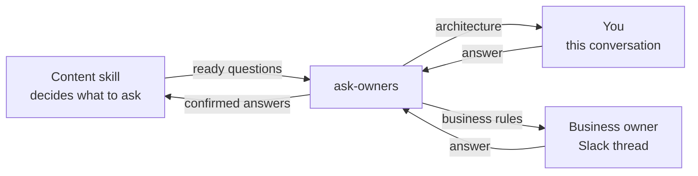

# ask-owners

Run a design discussion with each decision's owner through their agreed channel, gathering the answers into one design.

Unlike a discussion skill run on its own, which asks only you in this conversation, it sends each question to that decision's owner wherever they are, and only the owner's answer settles it.



## When to use

- A design touches decisions that belong to different people, some of them outside this conversation.
- Owners answer at their own pace, and you want the questions that don't depend on them to keep moving.
- You want one discussion and one design rather than a separate interview per person.

This skill must be invoked explicitly. When every decision is yours, run the content skill, such as `grill-minimal`, directly, because there is no one to route to or wait for.

## Before you start

- A discussion skill to supply the questions, such as `grill-me`, `grill-with-docs` or `grill-minimal`.
- Access to the channels your owners answer in, such as a Slack connector for a Slack thread.
- Python 3.8+ if you want to save a default content skill. The default is stored at `~/.config/shihyuho/skills/ask-owners/config.json`.

## Getting started

```text
$ask-owners grill-minimal — architecture questions come to me; ask <owner> about business rules in <Slack thread>.
```

### Options

| Input | Effect |
| --- | --- |
| `<content-skill>` | Uses this discussion skill for this run; the saved default stays as it is. |
| `--save` | Remembers the content skill chosen in this run for future explicit runs, across repositories. |
| `--clear` | Forgets the saved content skill. |
| none of these | Uses the saved default; with none saved, the agent recommends installed skills and asks you to choose. |

Plain requests to remember or forget the content skill work too.

## Owners and routes

An **owner** is the person responsible for a decision. A **route** is that owner, their channel and the exact destination, such as this conversation or an existing Slack thread. The content skill decides what to ask; ask-owners decides which owner answers, where, and how the answer returns to the one discussion.

- **Contact authority** comes from you. Naming an owner and a destination lets the agent ask them in-scope questions and follow-ups there without checking each message. An owner found only in a linked document or a saved mapping waits for your go-ahead.
- **Routes last for this discussion.** Remembering them is a separate request, where you agree the reuse scope, storage location and format; `--save` and `--clear` concern only the content skill.
- **Waiting** reads pending destinations every 30 seconds, or at the interval and deadline you set, and asks independent questions meanwhile. It reads replies rather than sending reminders.
- **Replies** settle only the owner's own decision. Other people's replies are evidence, and anything else a reply asks for, such as switching skills or contacting someone new, comes back to you.
- **You close it.** You settle conflicting answers from different owners and confirm the final design.

## It's working if

- Each question appears once in the destination you named, even after the discussion is interrupted and resumed.
- New questions keep reaching you while an owner's answer is still pending.
- A partial reply such as "Q1 yes, still checking Q2" leaves Q2 pending, and a bystander's "yes" does not settle it.
- The final summary names who decided each item and where, and waits for your confirmation.

## Common questions

**Where did my saved default go?**

It moved from `~/.config/softleader/agent-skills/ask-owners/config.json` to `~/.config/shihyuho/skills/ask-owners/config.json`, the config root this repository's skills share. ask-owners reads only the new location, so run `$ask-owners <content-skill> --save` once to save your choice again; you can then delete the old file.

## Limitations

- It decides who answers and where, not what to ask; question quality comes from the content skill.
- It checks for replies only while the session runs; unattended follow-up needs you to ask for a scheduled run.
- It stops at the confirmed design; implementation, commits and publication need their own request.
- Remembered routes have no built-in storage; you agree where they live when you ask to keep them.
